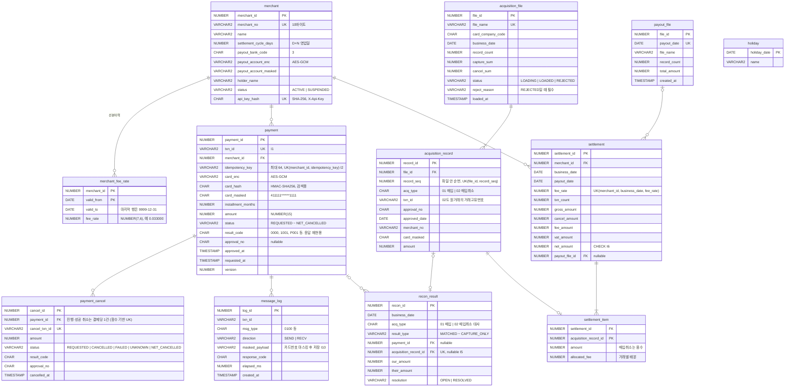

# 01. ERD (Oracle)



제약 조건(이름 포함)과 인덱스의 전체 목록은 `core/src/main/resources/db/migration/V1__create_tables.sql`이 원본이다. 마이그레이션 위치와 실행 주체는 [ADR-0006](adr/0006-schema-migration.md).

Spring Batch 메타데이터 테이블(`BATCH_*`)은 Spring Batch가 제공하는 Oracle용 스크립트를 Flyway 마이그레이션으로 관리한다.

## 설계 메모

**정산 계산 예시** — 가맹점 1곳, 매입 10건 × 1,010원, 수수료율 3.3%

| 항목 | 계산 | 값 |
|---|---|---|
| 거래 합계 | 10 × 1,010 | 10,100 |
| 수수료 | 10,100 × 0.033 = 333.3 → 원 미만 절사 | 333 |
| 부가세 | 333 × 0.1 = 33.3 → 원 미만 절사 | 33 |
| 지급액 | 10,100 − 333 − 33 | **9,734** |

수수료를 **거래마다 계산해서 더하면** 1,010 × 0.033 = 33.33 → 33, × 10건 = 330원으로 3원이 적다. 어디서 절사하느냐에 따라 합계가 달라지므로 규칙을 [ADR-0004](adr/0004-money-calculation.md)에 정했다.

**거래별 수수료 배분** — 가맹점 보고서에는 거래마다 수수료가 보여야 한다. 정산 합계로 계산한 333원을 10건에 나누면 33.3원씩이라, 각 33원(합 330원)을 먼저 주고 남은 3원을 소수부가 큰 순서로 1원씩 준다(최대 잉여 배분법). 소수부가 모두 0.3으로 같으므로 **동점이면 `acquisition_record_id` 오름차순**으로 정한다. 그래야 몇 번을 다시 돌려도 같은 결과가 나온다.

**왜 정산을 `fee_rate`까지 묶어서 만드나** — 같은 매입일 안에서 수수료율이 바뀌는 경우(선분이력 경계)가 있다. 거래마다 승인일 기준 요율을 찾고, 요율별로 정산 행을 나눈다.

**지급액이 음수면** — 그날 매입취소가 매입보다 크면 지급액이 음수가 된다. v1은 지급 파일에서 제외하고 OPEN으로 남긴다. 다음 정산과의 상계는 완성선 이후.

**취소는 결제당 여러 번 시도할 수 있지만, 진행 중이거나 성공한 취소는 하나뿐** — 실패한 취소(`FAILED`, `NET_CANCELLED`) 뒤에는 다시 취소할 수 있어야 한다 ([03-api.md](03-api.md) 5장). Postgres라면 `WHERE` 조건이 붙은 부분 유니크 인덱스로 쓰겠지만 Oracle에는 그 문법이 없다. 대신 **모든 키 값이 NULL인 행은 B-tree 인덱스에 들어가지 않는다**는 성질을 쓴다.

```sql
CREATE UNIQUE INDEX uk_payment_cancel_active ON payment_cancel (
    CASE WHEN status IN ('REQUESTED', 'UNKNOWN', 'CANCELLED') THEN payment_id END
);
```

`FAILED`, `NET_CANCELLED` 행은 식의 값이 NULL이라 인덱스에 없고, 나머지 상태만 결제당 하나로 제한된다. 동시에 두 취소 요청이 들어오면 두 번째 INSERT가 ORA-00001로 막힌다.

**거부된 매입 파일** — 헤더나 트레일러를 읽지 못해 거부될 수 있으므로, `REJECTED`인 행은 건수·합계가 비어 있어도 된다. 대신 `reject_reason`이 있어야 한다 (CHECK 제약).

**매입 레코드 순번** — `record_seq`는 파일 안에서 몇 번째 데이터 레코드인지다. 적재 배치가 재시작될 때 같은 레코드를 두 번 넣는 버그가 있어도 `UK(file_id, record_seq)`가 막는다 ([04-batch.md](04-batch.md)).

**문자열 길이는 `CHAR` 단위로** — DB 문자셋은 AL32UTF8이고, `VARCHAR2(n)`의 기본 단위는 **바이트**다. 한글 1자가 3바이트라 `VARCHAR2(10)`에 "홍길동카페"(15바이트)를 넣으면 ORA-12899가 난다 (2026-10-13 확인). 전문의 MS949 길이(40바이트 = 한글 20자)와 DB 길이는 단위가 다르므로, 한글이 들어가는 컬럼은 `VARCHAR2(n CHAR)`로 선언한다.

**시간** — 모든 시각은 KST로 저장한다 (`TIMESTAMP`). 날짜 의미만 있는 값(매입일, 지급일, 수수료율 기간)은 `DATE`의 시분초를 0으로 둔다.
