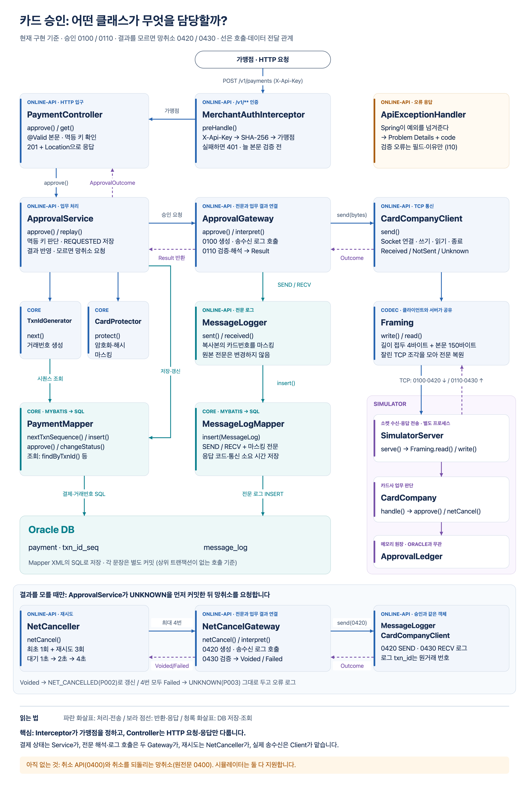
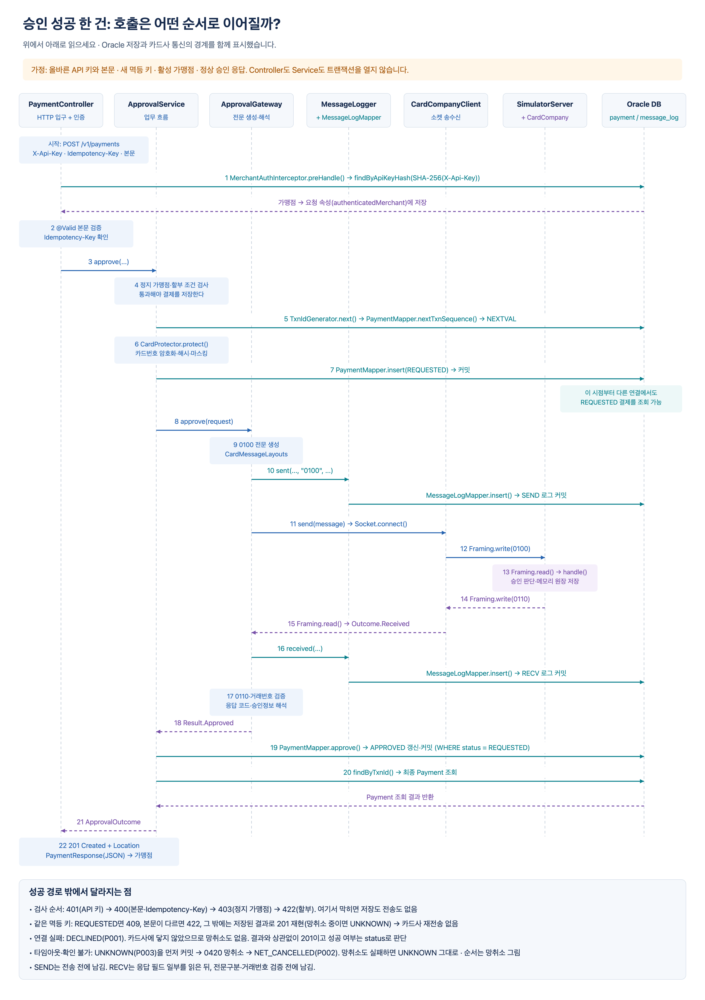
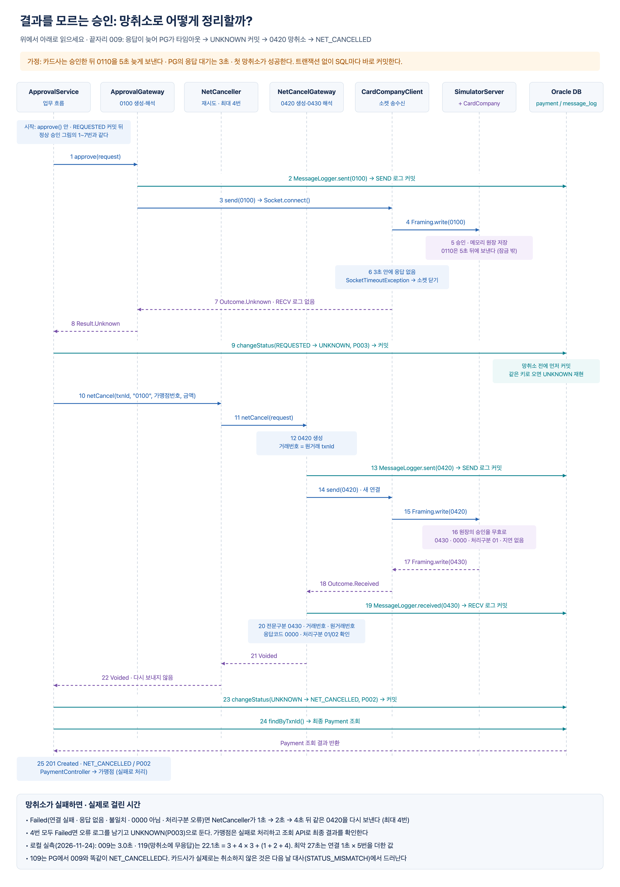

# 승인 요청·응답의 클래스 흐름

현재 구현된 **승인 API(`POST /v1/payments`) → 0100 승인 요청 → 0110 승인 응답**과, 응답을 확인하지 못했을 때의 **0420 망취소 → 0430 망취소 응답**을 정리한다. 클래스 연결도는 책임의 분리를, 두 시퀀스 다이어그램은 정상 승인과 망취소의 호출 순서를 보여 준다. HTTP 계약과 설계 이유는 [03-api.md](03-api.md)에 있다.

## 클래스 연결도

[확대 가능한 SVG](diagrams/approval-class-flow.svg)

| 클래스 | 실제 역할 |
|---|---|
| [MerchantAuthInterceptor](../online-api/src/main/java/io/github/kkw855/settlement/online/web/MerchantAuthInterceptor.java) | `/v1/**` 요청마다 `X-Api-Key`의 SHA-256으로 가맹점을 찾아 요청 속성에 넣는다. 키가 없거나 틀리면 401이다. [WebConfig](../online-api/src/main/java/io/github/kkw855/settlement/online/web/WebConfig.java)가 등록한다. |
| [MerchantMapper](../core/src/main/java/io/github/kkw855/settlement/core/merchant/MerchantMapper.java) | `findByApiKeyHash()`로 API 키 해시에 맞는 가맹점을 조회한다. 해시는 [ApiKeys](../core/src/main/java/io/github/kkw855/settlement/core/merchant/ApiKeys.java)가 만든다. |
| [PaymentController](../online-api/src/main/java/io/github/kkw855/settlement/online/payment/PaymentController.java) | 본문([ApprovePaymentRequest](../online-api/src/main/java/io/github/kkw855/settlement/online/payment/ApprovePaymentRequest.java))을 `@Valid`로 검증하고 `Idempotency-Key`를 확인한 뒤 서비스를 부른다. 결과를 [PaymentResponse](../online-api/src/main/java/io/github/kkw855/settlement/online/payment/PaymentResponse.java)로 바꿔 201 + `Location`으로 응답한다. 조회(`GET`)는 [PaymentQueryService](../online-api/src/main/java/io/github/kkw855/settlement/online/payment/PaymentQueryService.java)에 맡긴다. |
| [ApiExceptionHandler](../online-api/src/main/java/io/github/kkw855/settlement/online/error/ApiExceptionHandler.java) | 예외를 RFC 9457 Problem Details + `code`로 바꾼다. 검증 오류에는 필드명과 이유만 담고 입력값은 담지 않는다 (I10). |
| [ApprovalService](../online-api/src/main/java/io/github/kkw855/settlement/online/payment/ApprovalService.java) | 요청 검증, 결제 저장, 멱등 처리, 카드사 호출, 결과 반영을 조율한다. 결과를 모르면 `UNKNOWN`을 먼저 저장하고 망취소를 요청한다. |
| [TxnIdGenerator](../core/src/main/java/io/github/kkw855/settlement/core/payment/TxnIdGenerator.java) | DB 시퀀스를 받아 거래고유번호를 만든다. |
| [CardProtector](../core/src/main/java/io/github/kkw855/settlement/core/card/CardProtector.java) | DB에 보관할 카드번호의 암호문·검색용 HMAC·마스킹 값을 만든다. |
| [PaymentMapper](../core/src/main/java/io/github/kkw855/settlement/core/payment/PaymentMapper.java) | [PaymentMapper.xml](../core/src/main/resources/mapper/PaymentMapper.xml)의 SQL로 Oracle `payment`를 저장·조회·변경한다. |
| [ApprovalGateway](../online-api/src/main/java/io/github/kkw855/settlement/online/card/ApprovalGateway.java) | 요청 전문을 조립하고 송수신 로그를 호출하며, 수신 전문을 업무 결과로 해석한다. |
| [NetCanceller](../online-api/src/main/java/io/github/kkw855/settlement/online/card/NetCanceller.java) | 망취소를 최대 4번(최초 1번 + 재시도 3번) 보낸다. 재시도 전 대기는 `card-company.net-cancel-retry-delays`(1초·2초·4초)를 따르고, 원거래가 무효로 확인되면 바로 멈춘다. 기다리는 중에 인터럽트되면 더 보내지 않는다. |
| [NetCancelGateway](../online-api/src/main/java/io/github/kkw855/settlement/online/card/NetCancelGateway.java) | [NetCancelRequest](../online-api/src/main/java/io/github/kkw855/settlement/online/card/NetCancelRequest.java)로 0420 전문을 조립하고 송수신 로그를 호출하며, 0430을 `Voided`(원거래 무효) 또는 `Failed`(확인하지 못함)로 해석한다. 한 번만 주고받는다. |
| [CardMessageLayouts](../online-api/src/main/java/io/github/kkw855/settlement/online/card/CardMessageLayouts.java) | PG 쪽 전문 필드의 위치·길이·타입을 정의한다. 응답코드·승인번호의 형식 규칙(`isResponseCode()`, `isApprovalNo()`)도 여기 있다. |
| [MessageLogger](../online-api/src/main/java/io/github/kkw855/settlement/online/card/MessageLogger.java) | 카드번호를 가린 전문을 `SEND` 또는 `RECV` 로그로 저장하도록 요청한다. 형식이 틀린 응답코드는 `response_code`에 넣지 않는다. |
| [MessageLogMapper](../core/src/main/java/io/github/kkw855/settlement/core/message/MessageLogMapper.java) | [MessageLogMapper.xml](../core/src/main/resources/mapper/MessageLogMapper.xml)의 SQL로 Oracle `message_log`에 기록한다. |
| [CardCompanyClient](../online-api/src/main/java/io/github/kkw855/settlement/online/card/CardCompanyClient.java) | 거래마다 소켓을 열고 연결·전송·응답 읽기·종료를 수행한다. |
| [Framing](../codec/src/main/java/io/github/kkw855/settlement/codec/Framing.java) | TCP 스트림에서 `[ASCII 길이 4바이트][전문 본문]`을 쓰고 읽는다. |
| [SimulatorServer](../simulator/src/main/java/io/github/kkw855/settlement/simulator/SimulatorServer.java) | 카드사 쪽에서 연결을 받고, 전문을 읽어 업무 로직에 전달한 뒤 응답을 전송한다. |
| [CardCompany](../simulator/src/main/java/io/github/kkw855/settlement/simulator/CardCompany.java) | 승인·거절을 판단하고 카드사 원장에 기록하며, 응답 본문과 지연 여부를 반환한다. 0420을 받으면 원장의 원거래를 무효로 만들고 0430으로 답한다 (끝자리 109·119는 일부러 다르게 답한다). |
| [ApprovalLedger](../simulator/src/main/java/io/github/kkw855/settlement/simulator/ApprovalLedger.java) | 카드사 승인 기록을 메모리 맵에 보관한다. PG의 Oracle DB와는 별개이며 재시작하면 사라진다. |

## 정상 승인 순서

[확대 가능한 SVG](diagrams/approval-sequence.svg)

1. 가맹점이 `POST /v1/payments`를 보낸다. `MerchantAuthInterceptor.preHandle()`이 `X-Api-Key`를 SHA-256으로 바꿔 `MerchantMapper.findByApiKeyHash()`로 가맹점을 찾고, 요청 속성(`authenticatedMerchant`)에 넣는다.
2. Spring MVC가 컨트롤러 매개변수를 만든다. 가맹점은 요청 속성에서 꺼내고(`@RequestAttribute`), 본문은 `ApprovePaymentRequest`로 읽어 `@Valid`로 검증한다. `PaymentController.approve()`는 `Idempotency-Key`를 확인한 뒤 `ApprovalService.approve()`에 가맹점, 멱등 키, 승인 요청 값을 넘긴다.
3. 서비스가 정지 가맹점과 할부 조건을 검사하고 `TxnIdGenerator.next()`로 거래고유번호를 만든다. `CardProtector.protect()`로 DB 보관용 카드 정보를 준비한다.
4. `PaymentMapper.insert()`가 `REQUESTED` 결제를 저장한다. 컨트롤러도 서비스도 Spring 트랜잭션을 열지 않으므로 이 Mapper 호출이 끝날 때 커밋된다.
5. `ApprovalGateway.approve()`가 `CardMessageLayouts.APPROVAL_REQUEST.writer()`로 0100 전문 본문을 만든다.
6. Gateway가 먼저 `MessageLogger.sent()`를 호출한다. Logger는 마스킹한 복사본을 `MessageLogMapper.insert()`로 `message_log`에 저장한다.
7. Gateway가 `CardCompanyClient.send()`를 호출한다. Client는 연결 후 `Framing.write()`로 요청을 보내고, `Framing.read()`로 응답을 기다린다. 사용한 소켓은 닫는다.
8. 카드사 쪽 `SimulatorServer.serve()`가 요청을 읽고 `CardCompany.handle()`을 호출한다. 0100이면 `approve()`가 승인 여부를 판단하고, 승인 시 `ApprovalLedger.save()`로 기록한다.
9. `CardCompany`는 `Reply.Respond(응답 본문, 지연 시간)`를 반환한다. 실제 대기와 `Framing.write()`는 `SimulatorServer`가 수행한다. 대기는 `CardCompany.handle()`의 잠금 밖에서 일어난다.
10. Client가 `Outcome.Received(응답 바이트)`를 반환하면 Gateway의 `interpret()`가 전문구분코드·응답코드를 읽어 `RECV` 로그를 기록한다. 그다음 전문구분코드·거래고유번호가 요청과 맞는지, 응답코드와 승인번호의 형식이 맞는지 확인한다 ([02-message-spec.md](02-message-spec.md) 1장의 응답 확인). 정상 응답은 `Result.Approved`가 된다.
11. 서비스가 `PaymentMapper.approve()`로 `REQUESTED → APPROVED`를 반영한다. 승인번호·승인일시·결과코드를 저장하고, 갱신한 결제를 다시 읽어 `ApprovalOutcome.Processed`로 반환한다.
12. 컨트롤러가 결제를 `PaymentResponse`로 바꿔 201 Created와 `Location: /v1/payments/{txnId}`로 응답한다. 카드번호는 마스킹 값만 나간다.

## 응답을 확인하지 못하면: 망취소

[확대 가능한 SVG](diagrams/approval-net-cancel-sequence.svg)

금액 끝자리 009(카드사가 승인한 뒤 응답을 5초 늦게 보낸다)로 따라간다. 위 1~9번(`REQUESTED` 저장, 0100 `SEND` 로그와 전송, 카드사의 승인·원장 기록)까지는 정상 승인과 같다. 카드사가 0110을 5초 뒤에야 보낼 뿐이다.

1. Client가 3초 안에 응답을 받지 못해 `Outcome.Unknown`을 반환하고, Gateway는 `Result.Unknown`을 돌려준다. 응답을 읽지 못했으므로 0110 `RECV` 로그는 없다.
2. 서비스가 `PaymentMapper.changeStatus()`로 `REQUESTED → UNKNOWN`(`P003`)을 먼저 커밋한다. 망취소는 재시도까지 최대 23초 걸린다. 그사이 앱이 멈춰도 결제는 "결과를 모르는 거래"로 남는다 ([00-domain.md](00-domain.md) 4장).
3. 서비스가 `NetCanceller.netCancel()`에 `NetCancelRequest`(원거래고유번호, 원전문구분코드 `0100`, 가맹점번호, 금액)를 넘긴다.
4. `NetCancelGateway.netCancel()`이 0420 전문을 만든다. 공통부의 거래고유번호에도 원거래고유번호를 쓴다 ([02-message-spec.md](02-message-spec.md) 3장). `SEND` 로그를 남긴 뒤 `CardCompanyClient.send()`로 보낸다. 거래마다 연결하므로 0100과는 다른 새 연결이다.
5. 시뮬레이터의 `CardCompany`가 원장에서 원거래를 찾아 무효로 만들고 0430(응답코드 `0000`, 처리구분 `01`)으로 바로 답한다. 0100 응답을 늦추는 중이어도 처리한다. 지연은 `handle()`의 잠금 밖에서 기다리기 때문이다.
6. Gateway가 0430을 `RECV`로 남긴 뒤 확인한다. 전문구분코드가 `0430`이고, 거래고유번호·원거래고유번호가 보낸 값과 같고, 응답코드가 `0000`이고, 처리구분이 `01`(취소함)이나 `02`(원거래 없음)이면 `Voided`다. 하나라도 어긋나면 `Failed`다 ([02-message-spec.md](02-message-spec.md) 1장의 응답 확인).
7. `Voided`면 `NetCanceller`는 다시 보내지 않는다. 서비스가 `UNKNOWN → NET_CANCELLED`(`P002`)로 바꾸고(`WHERE status = 'UNKNOWN'`), 갱신한 결제를 다시 읽어 반환한다. 응답은 201이고, 가맹점에는 실패다.

망취소가 실패하면 이렇게 된다. [NetCancellerTest](../online-api/src/test/java/io/github/kkw855/settlement/online/card/NetCancellerTest.java)와 [V14 테스트](../online-api/src/test/java/io/github/kkw855/settlement/online/payment/ApprovalServiceTest.java)가 확인한다.

- `Failed`면 1초, 2초, 4초를 기다렸다가 같은 0420을 다시 보낸다. 최초 1번과 재시도 3번, 최대 4번이다. 설정은 대기 시간의 목록이라 목록의 길이가 곧 재시도 횟수다.
- 연결 실패(`NotSent`)도 다시 보낸다. 0100이 나가지 못했으면 카드사에 거래가 없으므로 `DECLINED`로 끝낸다. 0420이 나가지 못했을 때는 원거래의 결과가 여전히 확정되지 않았다.
- 4번 모두 `Failed`면 오류 로그를 남기고 `UNKNOWN`(`P003`)으로 둔다. 가맹점은 실패로 처리하고, 최종 결과는 조회 API로 확인한다 ([03-api.md](03-api.md) 3장).
- 기다리는 중에 인터럽트되면 더 보내지 않고 인터럽트 상태를 되살린다. 결제는 `UNKNOWN`으로 남는다.

로컬에서 실제 시뮬레이터로 잰 결과다 (2026-11-24, [06-local-run.md](06-local-run.md) 4장).

| 끝자리 | 시뮬레이터가 0420에 하는 일 | PG 결과 | 걸린 시간 |
|---|---|---|---|
| `009` | `01`로 답하고 원거래를 무효로 만든다 | `NET_CANCELLED` / `P002` | 3.0초 |
| `109` | `01`로 답하지만 실제로는 취소하지 않는다 | `NET_CANCELLED` / `P002` | 3.0초 |
| `119` | 답하지 않는다 | `UNKNOWN` / `P003` | 22.1초 |

- 119는 0100 응답 대기 3초 + 0420 4번 × 응답 대기 3초 + 재시도 대기 (1 + 2 + 4)초 = 22초다. 응답 시간 상한 27초([03-api.md](03-api.md) 4장)는 여기에 연결 타임아웃 1초 × 5번을 더한 값이다. 로컬에서는 연결이 바로 되므로 그만큼 짧다.
- 109는 PG만 보면 009와 구별되지 않는다. 다음 날 매입 파일과 대사할 때 `STATUS_MISMATCH`로 드러난다 ([02-message-spec.md](02-message-spec.md) 4장).

## 검사 순서: 저장하기 전에 거절한다

요청은 아래 순서로 검사한다. 1~5에서 막히면 결제 행도, 거래고유번호 채번도, 전문도 없다.

| 순서 | 검사 | 하는 곳 | 실패 응답 |
|---|---|---|---|
| 1 | API 키 | `MerchantAuthInterceptor` | 401 `UNAUTHORIZED` |
| 2 | 본문 형식 (JSON 읽기, `@Valid`) | Spring MVC 매개변수 생성 | 400 `VALIDATION_FAILED` |
| 3 | `Idempotency-Key` 유무·형식 | `PaymentController` | 400 `IDEMPOTENCY_KEY_REQUIRED` / `VALIDATION_FAILED` |
| 4 | 정지 가맹점 | `ApprovalService` | 403 `MERCHANT_SUSPENDED` |
| 5 | 5만 원 미만 할부 | `ApprovalService` | 422 `INSTALLMENT_NOT_ALLOWED` |
| 6 | 같은 멱등 키 | `payment`의 UNIQUE 제약 (INSERT) | 아래 "멱등 키" 절 |

- **인증이 늘 먼저다.** 인터셉터는 컨트롤러 매개변수를 만들기 전에 돈다. 그래서 키가 틀린 요청은 본문이 틀려도 401이다 ([03-api.md](03-api.md) 6장).
- **정지 검사는 INSERT보다 앞이어야 한다.** INSERT 뒤에서 거절해도 응답(403)은 같다. 하지만 카드사에 보내지 않은 `REQUESTED` 행이 남는다. 이 행에는 결과가 오지 않으므로, 같은 키로 다시 보내면 6번에서 계속 409다. 가맹점을 다시 활성화해도 그 키는 막힌다. [V11 테스트](../online-api/src/test/java/io/github/kkw855/settlement/online/payment/ApprovalServiceTest.java)가 정지 가맹점의 요청이 결제를 남기지 않는지 확인한다.
- **정지 검사는 인터셉터가 아니라 서비스가 한다.** 정지 가맹점도 정지 전 거래는 조회할 수 있어야 한다. 막을 요청이 무엇인지는 서비스가 안다.

## 전송 결과와 업무 결과는 다르다

`CardCompanyClient.Outcome`은 **네트워크에서 무엇을 확인했는지**, `ApprovalGateway.Result`는 **응답을 해석한 결과**, `Payment.status`는 **PG가 DB에 남긴 결제 상태**다.

| Client의 Outcome | Gateway의 Result | 먼저 저장하는 상태·결과코드 | 망취소 뒤 |
|---|---|---|---|
| `Received` + 요청과 일치하는 정상 승인 응답 | `Approved` | `APPROVED` / `0000` | 망취소 없음 |
| `Received` + 요청과 일치하는 거절 응답 | `Declined` | `DECLINED` / 카드사 응답코드 | 망취소 없음 |
| `Received` + 불일치·필드 해석 실패·응답코드나 승인번호의 형식 오류 | `Unknown` | `UNKNOWN` / `P003` | `NET_CANCELLED` / `P002`. 망취소도 실패하면 `UNKNOWN` / `P003` 그대로 |
| 연결 실패로 `NotSent` | `NotSent` | `DECLINED` / `P001` | 망취소 없음 (카드사에 닿지 않았다) |
| 연결 후 타임아웃·쓰기/읽기 실패 등으로 `Unknown` | `Unknown` | `UNKNOWN` / `P003` | `NET_CANCELLED` / `P002`. 망취소도 실패하면 `UNKNOWN` / `P003` 그대로 |

`Received`만으로 승인을 뜻하지 않는다. 반대로 PG가 타임아웃이어도 카드사는 이미 승인했을 수 있다. 시뮬레이터도 원장에 승인부터 기록하고 지연 응답을 보낸다. 응답코드가 `0000`이어도 승인번호 형식이 틀리면 `Unknown`이다. 카드사에는 승인이 남아 있지만 PG는 그 승인번호를 저장할 수 없으므로 망취소로 되돌린다.

결제 행을 만든 뒤에는 결과가 무엇이든 HTTP 201이다. 성공 여부는 본문의 `status`로 판단한다 ([03-api.md](03-api.md) 1장).

## 트랜잭션 경계

`PaymentController`와 `ApprovalService`에는 `@Transactional`이 없다. 그래서 HTTP 요청 경로에서는 결제 INSERT, 로그 INSERT, 결과 UPDATE 등 각 Mapper 호출이 개별 커밋되고, 카드사 응답을 기다리는 동안 이 호출 흐름을 감싸는 Spring 트랜잭션이 없다. [V10 테스트](../online-api/src/test/java/io/github/kkw855/settlement/online/payment/ApprovalServiceTest.java)가 그 시점에 `REQUESTED` 행이 별도 연결에서 보이는지 확인한다.

망취소도 같다. `UNKNOWN`은 0420을 보내기 전에 커밋되고, 망취소를 기다리는 동안(최대 23초)에도 트랜잭션이 없다. [V15 테스트](../online-api/src/test/java/io/github/kkw855/settlement/online/payment/ApprovalServiceTest.java)가 0420을 보내는 순간 별도 연결에서 `UNKNOWN`이 보이는지 확인한다.

다른 코드가 트랜잭션을 연 채 서비스를 부르면 이 경계는 달라질 수 있다. 어노테이션이 없다는 이유만으로 기존 트랜잭션이 중단되는 것은 아니다. 또한 결제 저장·로그 저장·카드사 원장 변경 전체가 하나의 원자적 트랜잭션으로 묶이는 구조도 아니다.

## 멱등 키가 중복이면 카드사 호출을 건너뛴다

`UNIQUE(merchant_id, idempotency_key)`에 의해 결제 INSERT가 중복 키 예외를 내면, 서비스가 기존 결제를 조회해 분기한다.

- 카드 해시·금액·할부개월이 다르면 `IDEMPOTENCY_KEY_REUSED` 오류다 (422).
- 같은 요청이지만 기존 상태가 `REQUESTED`이면 `PAYMENT_IN_PROGRESS` 오류다 (409, `Retry-After: 5`).
- 그 밖에는 기존 결과를 `ApprovalOutcome.Replayed`로 반환한다. 컨트롤러는 처음과 같은 201 본문에 `Idempotent-Replayed: true`를 붙인다.
- 망취소 중에 같은 키로 오면 `UNKNOWN`이 이미 커밋되어 있으므로 409가 아니라 `UNKNOWN` / `P003`이 재현된다. 가맹점은 실패로 처리하고, 최종 결과는 조회로 확인한다 ([03-api.md](03-api.md) 3장).

이 경로에서는 Gateway에 진입하지 않으므로 카드사에 0100이나 0420을 다시 보내지 않고, 새로운 송수신 로그도 남기지 않는다. 거래고유번호 생성과 카드 보호 처리는 중복 INSERT 시도 전에 이미 수행된다.

## 오류 응답

`ApiException`은 `ErrorCode`를 담고, HTTP 상태는 `ErrorCode`가 정한다. `ApiExceptionHandler`가 이를 Problem Details(`application/problem+json`)로 바꾸고 `code`를 붙인다.

- `@Valid` 실패는 400 `VALIDATION_FAILED`와 `errors`(필드·이유)로 나간다. 같은 요청에 늘 같은 응답이 나가도록 필드명, 이유 순으로 정렬한다.
- JSON 문법 오류나 타입 불일치(소수 금액 포함)도 400 `VALIDATION_FAILED`다. 예외 메시지에 입력값이 들어 있을 수 있어 응답에 옮기지 않는다.
- 예상하지 못한 예외는 500 `INTERNAL_ERROR`다. 스택 트레이스는 로그에만 남긴다.
- 지원하지 않는 메서드(405), 지원하지 않는 Content-Type(415), 키가 맞는데 없는 경로(404)는 Spring 기본 Problem이라 `code`가 없다 ([openapi.yaml](api/openapi.yaml)의 Problem).

## 로그를 읽을 때 주의할 점

- **`SEND`는 전달 성공 증거가 아니다.** 연결 시도보다 먼저 기록하므로 연결 실패에도 남을 수 있다.
- **`RECV`는 승인 성공 증거가 아니다.** `interpret()`에서 응답코드·전문구분코드를 초기 파싱한 뒤, 요청 일치 여부와 승인 여부를 검증하기 전에 기록한다.
- 연결 실패·응답 타임아웃에는 `RECV`가 없다. 응답을 받았어도 길이가 150바이트가 아니거나, 전문구분코드가 숫자가 아니거나, 응답코드를 MS949로 읽을 수 없으면 기록하기 전에 실패하므로 `RECV`가 남지 않는다. 그 뒤의 필드(거래고유번호·승인번호·승인일시)에서 실패하면 `RECV`는 남는다.
- 응답코드가 숫자 4자리가 아니면 `response_code`는 비우고 원문(`masked_payload`)은 그대로 남긴다. `response_code`는 바이트 단위 `CHAR(4)`라 `거절` 같은 값을 넣으면 저장이 실패한다 (ORA-12899). 원문 컬럼은 문자 단위(`VARCHAR2(200 CHAR)`)라 그대로 들어간다.
- `elapsedMs`는 Gateway가 Client의 `send()` 호출 전후에 측정한 경과 시간이다. 카드사 내부 처리 시간만을 뜻하지 않는다.
- Logger는 `Arrays.copyOf()`로 새 배열을 만들고, 0100의 카드번호 가운데 6자리를 `*`로 가린다. 실제 전송에 쓰는 원본 배열은 변경하지 않는다. 0420·0430에는 카드번호가 없다.
- **0420·0430도 원거래의 거래고유번호로 남는다.** 0420 공통부의 거래고유번호에 원거래고유번호를 쓰기 때문이다. 그래서 `txn_id` 하나로 0100부터 0430까지 이어서 볼 수 있다.
- 끝자리별로 남는 행 (2026-11-24 로컬): 009와 109는 0100 `SEND` → 0420 `SEND` → 0430 `RECV`(`0000`) 3행이다. 119는 0100 `SEND` 1행과 0420 `SEND` 4행뿐이고 `RECV`는 없다. 0420 `SEND` 사이의 간격(약 4초·5초·7초)은 응답 대기 3초에 재시도 대기 1·2·4초를 더한 값이다.

취소 API(`POST /v1/payments/{txnId}/cancel`, 0400)와 취소를 되돌리는 망취소(원전문구분코드 `0400`)는 아직 구현하지 않았다. 시뮬레이터는 둘 다 지원한다. 구현할 때는 `NetCanceller`를 그대로 쓰고 원전문구분코드만 `0400`으로 넘긴다.
